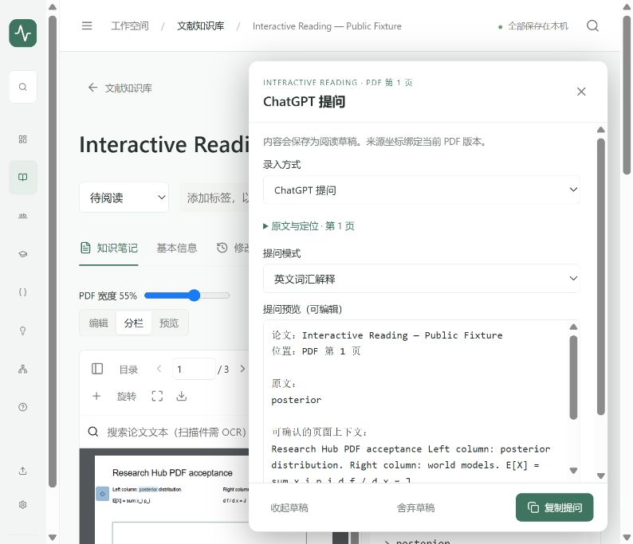

# Research Hub

[源码仓库](https://github.com/ZzxGeorge/ResearchHub) · [Windows 安装包与版本发布](https://github.com/ZzxGeorge/ResearchHub/releases) · [使用手册](docs/user_guide.md) · [已知限制](DEVELOPMENT_STATUS.md)

本地优先的个人科研知识中心。React / TypeScript + FastAPI / SQLAlchemy + SQLite / Markdown，无账号、无云端、无付费 API。当前版本 **0.3.0**。

已实现六类知识管理、Markdown / LaTeX / Mermaid、PDF 分栏、双向关联、结构化导入、跨库全文检索、SM-2 词汇复习、知识图谱、想法看板、版本历史、回收站、导出和备份恢复。正式知识库初始为空；示例不会自动导入。

实际交付范围、验收结果和限制见 [DEVELOPMENT_STATUS.md](DEVELOPMENT_STATUS.md)。这是一份可运行的初始版本；长期存储请建立独立备份，升级前先备份。

## v0.3 交互阅读

选中 PDF 原文 → 记录词汇/数学/算法/想法/问题 → 自动保留页码与选区 → 随时返回原文。支持持久高亮、Markdown/LaTeX 批注、重复词汇追加、待完善词汇、原文插入笔记及六种 ChatGPT 提问模板。

[新功能使用说明](docs/interactive_reading.md) · [来源与批注数据模型](docs/source_anchor_model.md)



## 基本功能

| 模块 | 功能 |
| --- | --- |
| 科研工作台 | 真实知识库统计、最近论文与笔记、待办、词汇复习入口 |
| 文献知识库 | 论文元数据、阅读与复现状态、标签筛选、PDF、本地附件和阅读笔记 |
| 数学 / 算法 / 科研想法 / 问题 | 分类管理、Markdown 模板、修改历史、回收站和双向关联 |
| 科研英语 | 多论文来源词汇积累、重复项确认、SM-2 闪卡与复习历史 |
| PDF 阅读 | 仅 PDF、仅笔记、分栏、连续滚动、选中文字、搜索高亮、目录、缩略图和位置恢复 |
| 知识编辑与检索 | LaTeX、Mermaid、代码高亮、自动保存与草稿恢复、全局搜索、知识图谱 |
| 导入与数据保存 | ChatGPT 总结 JSON 校验 / 预览 / 合并，Markdown / JSON / CSV 导出，完整备份恢复 |

## 第一次使用

**普通 Windows 用户：**从 [Releases](https://github.com/ZzxGeorge/ResearchHub/releases) 下载 `ResearchHub-Setup-0.3.0-x64.exe`，按向导安装，再双击桌面或开始菜单中的 **Research Hub**。无需自行安装 Python、Node.js 或 npm。安装包未签名，系统可能显示未知发布者提示。

**准备修改源码：**先克隆仓库，再按下文安装开发依赖。Git 仓库不存储安装包、构建目录或个人科研数据；安装包在 Releases 独立发布。

```bash
git clone https://github.com/ZzxGeorge/ResearchHub.git
cd ResearchHub
```

建议先添加一篇论文，在笔记中记录理解，再关联数学、算法和问题。初次启动的正式知识库为空，`examples/` 中的示例仅供自选导入。


## Windows 桌面版 v0.3.0

下载：[v0.3.0 Windows 安装包](https://github.com/ZzxGeorge/ResearchHub/releases/download/v0.3.0/ResearchHub-Setup-0.3.0-x64.exe)。自行构建后的文件位于 `release/ResearchHub-Setup-0.3.0-x64.exe`。双击安装，默认当前用户安装到 `%LOCALAPPDATA%/Programs/Research Hub`，可选择安装路径。安装后使用桌面或开始菜单的 **Research Hub** 启动；无需 Python、Node 或外部浏览器。请使用安装包，不要直接运行源码工作区里的 win-unpacked 验收包。

桌面版自动识别原有 `~/.research-hub/workspace`；也接受 `--workspace` 和 `RESEARCH_HUB_WORKSPACE`。设置页面可查看软件版本、打开工作空间 / 日志目录、选择其他数据目录并重启。安装、覆盖安装和卸载不会删除科研工作空间。旧数据库实际升级前自动生成完整备份。

PDF 增加仅 PDF / 仅笔记 / 分栏、连续滚动、文本选择、搜索高亮、缩略图、内置目录、页码跳转、适宽 / 整页和阅读位置保存。沿用 PDF.js 4.10.38，全部资源本地打包。新增选文工具栏、精确原文出处、快速收集知识、高亮批注、双向跳转与 ChatGPT 提问复制；OCR 和区域截图暂未实现。

重新打包（开发机需要 Python 3.10+、Node 22/24 和 npm）：

```powershell
.\scripts\build_windows.ps1
```

首次构建会联网下载锁定依赖；已安装依赖时可加 `-SkipInstall`。产物在 release，构建中间文件在 build。未进行数字签名，Windows 可能显示 SmartScreen 或未知发布者提示；如遇系统阻止，请由用户自行核验和处理，软件不会更改安全设置。

详见 [桌面架构](docs/desktop_architecture.md)、[安装、升级与故障处理](docs/windows_installation.md)、[v0.3 验收记录](docs/verification-v030.md)。下列 Python / 浏览器启动方式继续保留用于开发。

## 环境

- Python 3.10–3.12（当前在 Windows / Python 3.10.13 验证）。
- Node.js 22 或 24、npm（当前 Node 24.15.0 验证）。
- 首次安装需联网下载开源依赖；安装完成后核心功能可离线使用。

## Windows 安装和运行

在项目根目录打开 PowerShell：

```powershell
python -m venv .venv
.\.venv\Scripts\python.exe -m pip install -r backend/requirements.lock.txt
Set-Location frontend
npm ci
npm run build
Set-Location ..
.\.venv\Scripts\python.exe scripts/start.py
```

打开 <http://127.0.0.1:8000>。用 Ctrl+C 停止服务。以后只需最后一条启动命令，不必重新安装。

也可运行 `./scripts/start.ps1`。若本机脚本策略禁止 PowerShell 脚本，直接使用上面的 Python 命令。

自定义独立数据目录和端口：

```powershell
.\.venv\Scripts\python.exe scripts/start.py --workspace 'D:\ResearchWorkspace' --port 8000
```

## Linux 安装和运行

```bash
python3 -m venv .venv
.venv/bin/python -m pip install -r backend/requirements.lock.txt
cd frontend
npm ci
npm run build
cd ..
bash scripts/start.sh --workspace "$HOME/ResearchWorkspace"
```

默认仅绑定 `127.0.0.1`。Linux 脚本和路径使用跨平台接口，但本次未在原生 Linux 上执行；不要将其视为已经完成的 Linux 运行认证。

## 数据在哪里

默认：`~/.research-hub/workspace`。可通过 `--workspace` 或 `RESEARCH_HUB_WORKSPACE` 指定目录。启动器禁止把 `--workspace` 指向源码目录内部。

```text
ResearchWorkspace/
├── workspace.json           # 非敏感格式配置
├── database/hub.sqlite3     # 元数据、关系、索引、复习与历史
├── literature/notes/        # 各论文的独立 Markdown 版本
├── literature/papers/       # PDF
├── vocabulary/
├── mathematics/
├── algorithms/
├── research_ideas/
├── questions/
├── attachments/
├── exports/
└── backups/
```

Markdown 是正文的权威来源，SQLite 是元数据和关系的权威来源。正文不会同时以数据库正文和文件正文两份独立数据维护。升级代码不要删除数据目录，不要手动移动其中单个文件或编辑 SQLite。

## 快速使用

1. 新建论文，填写标题即可；在「基本信息」补充元数据与状态。
2. 在详情页上传 PDF，使用「PDF 分栏」对照笔记；正文约 1.4 秒自动保存，也可 Ctrl+S。
3. 在右侧建立数学、算法、词汇、问题与想法关联，入边和出边均可查看。
4. 在 ChatGPT 阅读对话中发送 [导出提示词](docs/chatgpt_export_prompt.md)，保存生成的 JSON。
5. 「导入与导出」粘贴 / 选择 JSON，校验，检查候选重复项和差异，选择新增 / 合并 / 跳过后确认。
6. Dashboard 进入词汇复习；Ctrl+K 跨库检索；设置中查看分类与回收站。
7. 定期生成完整备份，并复制到独立磁盘。网页下载和服务端备份目录都会保留 ZIP。

## 项目结构

```text
backend/app/              FastAPI API、Pydantic 协议、SQLAlchemy 模型、服务和文件存储
backend/migrations/       Alembic 数据库版本
backend/tests/            API 与服务验收、故障注入、恢复与安全测试
desktop/                  Electron 窗口、受控 IPC、进程管理与安装配置
frontend/src/             React 界面、知识编辑器、导入、图谱、复习
frontend/tests/           Markdown 安全 / 公式与自动保存竞态测试
schemas/                  由代码生成的 v1 JSON Schema
examples/                 可选且明确标注的验收示例
scripts/                  跨平台启动、维护和协议生成
docs/                     架构、数据库、协议、使用与验收文档
```

## 开发与测试

```powershell
.\.venv\Scripts\python.exe -m pytest
.\.venv\Scripts\python.exe scripts/generate_protocol.py
Set-Location frontend
npm test
npm run build
```

桌面壳策略测试：在项目根目录运行 `node --test desktop/tests/*.test.cjs`。历史版本兼容性测试需要仓库中的 `v0.1.0` 和 `v0.2.0` 标签；请保留 Git 历史和标签。

Linux 将 Python 路径替换为 `.venv/bin/python`。协议生成器同时生成 Schema 与 ChatGPT 提示词；测试验证它们与实际 API 一致。

开发模式在两个终端启动：

```powershell
$env:RESEARCH_HUB_WORKSPACE = 'D:\ResearchWorkspaceDev'
.\.venv\Scripts\python.exe -m uvicorn app.main:create_app --factory --app-dir backend --host 127.0.0.1 --port 8000
```

```powershell
Set-Location frontend
npm run dev
```

打开 Vite 输出的 Local 地址。API 文档为 <http://127.0.0.1:8000/docs>；Vite 代理 `/api` 到后端。标准安装只需一个后端进程提供前端静态文件。

## 备份、恢复与迁移

完整操作见 [用户手册](docs/user_guide.md)。命令行支持大于网页 50 MB 上限的备份：

```powershell
.\.venv\Scripts\python.exe scripts/workspace.py backup --workspace 'D:\ResearchWorkspace' --output 'D:\ResearchBackups'
.\.venv\Scripts\python.exe scripts/workspace.py restore 'D:\ResearchBackups\backup.zip' --target 'D:\RestoredResearchWorkspace'
.\.venv\Scripts\python.exe scripts/workspace.py migrate --workspace 'D:\RestoredResearchWorkspace'
.\.venv\Scripts\python.exe scripts/workspace.py reindex --workspace 'D:\RestoredResearchWorkspace'
```

恢复目标必须不存在；恢复不覆盖已有工作空间。校验成功后切换启动目录即可。升级启动时自动运行 Alembic `upgrade head`，不自动执行破坏性降级。

## GitHub 同步与更新

本项目的远程仓库为 `https://github.com/ZzxGeorge/ResearchHub.git`，主要分支为 `main`。后续在本项目中完成的优化，应先运行与变更相关的检查，更新使用文档和开发状态，再提交并推送源码；发布新版本时另行上传对应安装包、版本说明和 SHA256。

```bash
git pull --ff-only origin main
# 完成修改、验证与文档更新后
git add <明确要提交的源码或文档路径>
git commit -m "说明本次改动"
git push origin main
```

不要将数据库、论文、个人想法笔记、用户工作空间、备份、日志、凭证、`.venv/` 或 `node_modules/` 提交到 Git。推送遇到远程更新时先检查并合并，不使用强制推送覆盖远程历史。GitHub 同步用于应用源码，个人知识库仍使用独立的本地备份。

有发布权限的维护者可在推送版本标签、构建并核验 `release/BUILD_INFO.json` 后运行 `.venv` 中的 Python 执行 `scripts/publish_github_release.py --tag v0.3.0`。脚本复用 Git Credential Manager 或现有 GitHub 令牌环境变量，先创建草稿、校验安装包及附件再发布；不会把凭证写入文件或上传个人知识库。

## 进一步阅读

- [用户手册](docs/user_guide.md)
- [架构与决策](docs/architecture.md)
- [数据库设计](docs/database_schema.md)
- [导入字段与异常处理](docs/import_format.md)
- [完整 JSON Schema](schemas/reading-summary-v1.schema.json)
- [ChatGPT 配套提示词](docs/chatgpt_export_prompt.md)
- [合法示例](examples/reading_summary.json) · [阅读中手动收集后的 v1 导入示例](examples/interactive_reading_v1.json)
- [验收记录](docs/verification.md)
- [长期开发规范](AGENTS.md)

实现参考：[FastAPI 文件上传](https://fastapi.tiangolo.com/tutorial/request-files/)、[React Effect 生命周期](https://react.dev/reference/react/useEffect)、[SQLite Backup API](https://sqlite.org/backup.html)。
